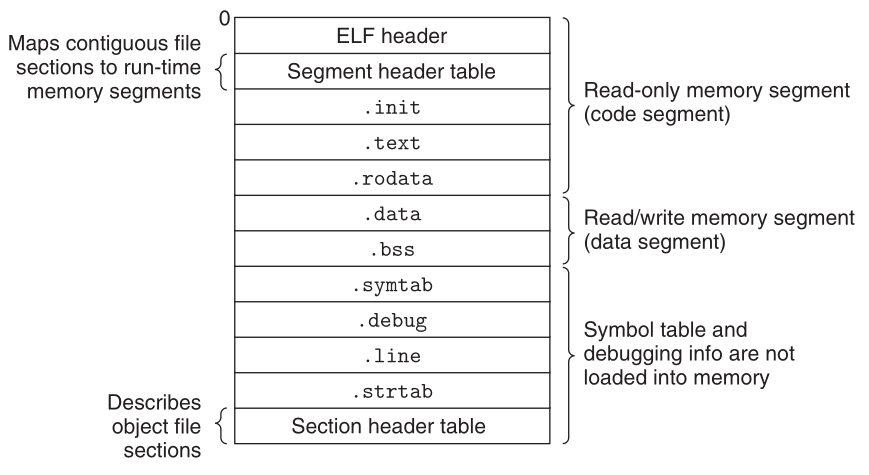
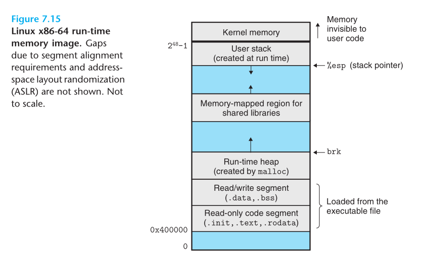
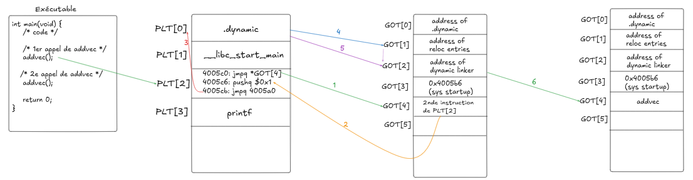

# Linking

## Fichiers objets

Il y a 3 types de fichiers objets:
 - `relogeables`: contiennent du code binaire et des données sous une forme qui peut être combinée avec d'autres fichiers objets relogeables, à la compilation ou à l'exécution.
 - `exécutables`: contiennent du code binaire et des données sous une forme qui peut être directement copiée en mémoire et exécutée
 - `partagés`: type spécial d'objet relogeable qui peut être chargé en mémoire et liée dynamiquement, au chargement ou à l'exécution
 
Les `compilers` et les `assemblers` génèrent des fichiers objets `relogeables` (ceci incluant les fichiers objets partagés). Les `linkers` génèrent des objets `exécutables`.

Sous Linux, le format historique `a.out` a été supplanté par le format `ELF` (pour Executable and Linkable Format).

## ELF Format

|Section|Description|
|:---:|---|
|ELF HEADER|Commence à l'adresse `0x0` dans le cas d'un fichier `relogeable`. L'entête débute par une séquence de 16 octets décrivant la taille d'un `word` et l'`endianness` du système qui a généré le fichier. La suite contient des informations qui permettront au `linker` de parser et interpréter le fichier objet: la taille de l'entête ELF, le type de l'objet (`relogeable`, `exécutable`, `partagé`), le type de la machine (ex: `x86-64`), le décalage de la `section header table`.|
|.text|Code machine du programme compilé.|
|.rodata|Données en lecture seule comme les `string` et les `jump table` des `switch`.|
|.data|Variables C `global` et `static` initialisées. Les variables `local` n'y apparaissent pas.|
|.bss|Variables C `global` et `static` non initialisées ainsi que les variables `global` ou `static` initialiées à 0. Cette section n'occupe aucun véritable espace dans le fichier objet, et sert à peine de `placeholder`. Les formats de fichiers objets distinguent les variables initialisées et non initialisées pour des questions d'optimisation de taille. Les variables non initialisées n'ont aucune place à occuper et sont allouées à l'exécution avec une valeur initiale de 0. L'acronyme `bss` provient d'une directive IBM de 1957, `block started by symbol`.|
|.symtab|Table des informations à propos des fonctions et des variables `global` qui sont définies et référencées dans le programme. **De nombreux programmeurs pensent à tort qu'un programme doit être compilé avec l'option `-g` pour obtenir cette table, alors qu'en réalité, tout objet `relogeable` a son symbole dans `.symtab` (à moins que le programmeur ait volontairement supprimé la table avec la commande `STRIP`)**. A l'inverse de la table des symboles à l'intérieur du compilateur, les variables `local` n'apparaissent pas dans cette section.|
|.rel.text|Liste des emplacements dans la section `.text` qui seront à modifier par le `linker` lorsqu'il liera le fichier objet concerné avec tous les autres. En principe, toute instruction qui `call` une fonction externe ou fait référence à une variable `global` doit être modifiée. Autrement, les instructions qui `call` des fonctions `local` n'ont pas besoin d'être modifiées. A noter également, les informations de relogement ne sont pas nécessaires pour les objets `executables` et sont donc omise, à moins que l'utilisateur ait explicitement demandé au `linker` de les inclure.|
|.rel.data|Informations de relogement de toute variable `global` qui référencée ou définie dans le programme. En principe, toute variabie `global` initialisée, dont la valeur initiale est l'adresse d'une variable `global` ou d'une fonction `extern` est à modifier.|
|.debug|Une table des symboles de débogage, avec des entrées relatives aux variables `locales`, daux `typedef`, aux variables `global` définies et référencées dans le programme, ainsi que le code C source. Cette table n'existe qu'avec l'option `-g`.|
|.line|La correspondance entre les lignes du code C source et les codes d'instruction machine de la section `.text`. Cette table n'existe qu'avec l'option `-g`.|
|.strtab|Une table de `string` correspondant aux tables des symboles des sections `.symtab` et `.debug` et pour les noms des titres de sections. Cette section est une séquence de `null-terminated strings`, vers le début desquelles pointent chaque entrée des tables `.symtab` et `.debug`.|
|Section header table|Décrit les sections des fichiers objets.|
||

### Symboles du linker

Dans le contexte d'un `linker`, il existe trois types de symboles associés à un module `m`: 
    - Les symboles `global` définis par `m` et qui peuvent être référencés par les autres modules. Il s'agit des symboles relatifs aux fonctions C `nonstatic` et aux variables `global`.
    - Les symboles `global` référencés par `m` et définis par les autres modules. Ce sont les symboles `external` qui correspondent à des fonctions C `nonstatic` et des varibales `global` définies dans d'autres modules.
    - Les symboles `local` qui sont définis et référencés exclusivement par le module `m`. Ils correspondent aux fonctions C `static` et aux variables `global` qui sont définies avec l'attribut `static`. Ces symboles sont uniquement visibles dans le module `m`.

> Il faut faire la différence entre les syumboles `local` au sens du `linker` et les variables `local` d'un programme.
> La table des symboles `.symtab` ne contient aucun symbole relatif à une variable `local` et `nonstatic` d'un programme. Ces dernières sont générées à l'exécution sur la `stack` et sont sans intérêt pour le `linker`.

### Cas des variables `local` et `static`

En ce qui concerne les variables `local` mais `static` d'une fonction ne sont pas gérées sur la `stack`. Le compilateur alloue un espace dans `.data` ou `.bss` pour chaque définition et crée un symbole de liaison `local` avec un nom unique.

Exemple:

```c
int f() {
    static int x = 0;
    return x;
}

int g() {
    static int x = 1;
    return x;
}
```
Dans ce cas le compilateur exporte deux symboles locaux avec des noms différents. Par exemple `x.1` et `x.2`.

### ELF `.symtab` et les `table entries`

Ces symboles font partie de la table des symboles. Cette table contient des entrées sous la forme suivante: 

```c
typedef struct {
    int     name;       /* String table offset */
    char    type:4,     /* Function or data */
            binding:4;  /* Local or global */
    char    reserved;   /* Unused */
    short   section;    /* Section header index */
    long    value;      /* Section offset or absolute address */
    long    size;       /* Object size in bytes */
} Elf64_Symbol;
```

Les champs se comprennent ainsi:
- `name`: offset en octet dans `.strtab`, vers le nom `null-terminated` du symbole.
- `value`: adresse du symbole. Dans le cas d'un objet `relogeable`, `value` est l'offset à partir du début de la section où l'objet est défini. Dans le cas d'un objet `exécutable`, c'est la valeur absolue à l'exécution.
- `size`: taille en octets de l'objet.
- `type`: type de l'objet: `data` ou `function`.
- `binding`: indique si le symbole est `local` ou `global`.
- `section`: assignation à une section du fichier objet. Il s'agit d'un indice dans la `section header table`.

La table des symboles peut aussi contenir des entrées pour les sections individuelles et le chemin du fichier source original:

```sh
// main.c
int count = 5;
int main() { return count; }

gcc -c main.c
readelf -s main.o

Sortie typique (simplifiée) :

Num:  Value  Size  Type     Bind    Ndx  Name
  0:  0      0     NOTYPE   LOCAL   UND
  1:  0      0     FILE     LOCAL   ABS  main.c       ← chemin du fichier source
  2:  0      0     SECTION  LOCAL   1    (.text)      ← symbole de section
  3:  0      0     SECTION  LOCAL   2    (.data)
  4:  0      0     SECTION  LOCAL   3    (.bss)
  5:  0      4     OBJECT   GLOBAL  2    count        ← vrai symbole (variable)
  6:  0      11    FUNC     GLOBAL  1    main         ← vrai symbole (fonction)
```

### Pseudosections sans entrée dans la `section header table`:
- `ABS`: symboles qui ne doivent pas être relogés.
- `UNDEF`: symboles indéfinis, c'est-à-dire des ssymboles référencés dans le module courant mais définis ailleurs.
- `COMMON`: représente les objets non initialisés et non encore alloués. Dans ce cas, le champ `value` précise l'alignement nécessaire, et `size` précise la taille minimum.

> Ces pseudosections n'existent que dans les fichiers objets `relogeables`, pas dans les fichiers `exécutables`.

### Distinction entre `COMMON` et `.bss`

La distinction est subtile:

- `COMMON`: variables `global` non initialisées.
- `.bss`: variables `static` non initialisées, et variables `global` ou `static` initialisées à 0.


### Practice problem 7.1

Soit le code suivant, remplir le tableau pour le fichier objet `swap.o`.

```c
/* m.c */
void swap();

int buf[2] = {1, 2};

int main() {
    swap();
    return 0;
}

/* swap.c */
extern int buf[];

int* bufp0 = &buf[0];
int* bufp1;

void swap() {
    int temp;

    bufp1 = &buf[1];
    temp = *bufp0;
    *bufp0 = *bufp1;
    *bufp1 = temp;
}
```

|Symbol|`.symtab` entry?|Symbol type|Module where defined|Section|
|:---:|:---:|:---:|:---:|:---:|
|buf|yes|extern|`m.o`|`.data`|
|bufp0|yes|global|`swap.o`|`.data`|
|bufp1|yes|global|`swap.o`|`COMMON`|
|swap|yes|global|`swap.o`|`.text`|
|temp|no|-|||


## Résolution des symboles

### Symboles locaux
Le linker n'autorise qu'une seule définition par symbole.
La résolution des symboles pour les références à des symboles locaux définis dans le même module que la référence est direct, en raison de la règle de la définition unique.
Le compilateur s'assure également que les variables locales `static` ont un nom unique, puisqu'elles obtiennent un symbole.

### Symboles globaux
La résolution des symboles globaux est en revanche plus technique.

Lorsque le compilateur tombe sur un symbole (une variable ou un nom de fonction) qui n'est pas localement défini, il émet l'hypothèse que la définition est réalisée dans un autre module. Il génère pour cela une entrée dans la table des symboles et délègue le soin de la résoudre au linker. En fin de compte, si le linker ne parvient pas à trouver de définition pour le symbole, il émet une erreur.

Exemple:

```c
/* linkererror.c */
void foo(void);

int main(void) {
    foo();
    return 0;
}
```

Donne l'erreur suivante au moment de la laison:

```sh
linux> gcc -Wall -Og -o linkerror linkerror.c
/tmp/ccSz5uti.o: In function ‘main’:
/tmp/ccSz5uti.o(.text+0x7): undefined reference to ‘foo’
```

La difficulté provient du fait que différents modules peuvent définir chacun des symboles globaux portant le même nom.
Le linker de Linux choisit entre deux stratégies pouvant conduire à des bogues incompréhensibless: lever une erreur ou choisir une définition et abandonner les autres.

### Règle de résolution des symboles dupliqués

Historiquement, le compilateur exportait chaque symbole `global` vers l'assembleur en tant que symbole `strong` ou `weak`. Les `fonctions` et les variables `global` initialisées étaient assorties de l'étiquette `strong`, et les variables `global` non initialisées de l'étiquette `weak`.

Les linkers de Linux opèrent selon ces règles:
- Règle 1: Plusieurs symboles `strong` portant le même nom sont interdits
- Règle 2: En présence d'un symbole `strong` et de plusieurs symboles `weak` portant le même nom, choisir le symbole `strong`
- Règle 3: En l'absence d'un symbole `strong` et de plusieurs symboles `weak` portant le même nom, choisir n'importe lequel des symboles `weak`

Cette règle est toujours en vigueur, mais depuis `gcc10`, les critères de déclaration par défaut ont changé.
Désormais, le comportement par défaut de `gcc` correspond à l'option implicite `-f-no-common`, tandis que le comportement historique correspondait à `-f-common`.

>Désormais, lorsque `gcc` (`-f-no-common` implicite) rencontre un symbole `global` non initialisé, il considère de facto que le module possède le symbole. Il réserve alors 4 octets dans `.bss` et émet un `GLOBAL`. Le symbole devient donc un symbole `strong` et toute nouvelle définition (obligatoirement `strong`) produira une erreur.
>
> Historiquement, `gcc` (`-f-common` implicite) rencontrait un symbole `global` non initialisé, il considérait ne pas être en mesure de déterminer le propriétaire du symbole. Il émettait un symbole `COMMON` sans section ni adressse (juste une taille et un alignement).

### Practice problem 7.2

Question A:
```c
/* Module 1 */
int main{}

/* Module 2 */
int main;
int p2() {}
```
```
(a) REF(main.1) -> DEF(main.1)
(b) REF(main.2) -> DEF(main.1)

car symbole STRONG (1) contre WEAK (2)
```

Question B:
```c
/* Module 1 */
int main{}

/* Module 2 */
int main = 1;
int p2() {}
```
```
(a) REF(main.1) -> DEF(ERREUR)
(b) REF(main.2) -> DEF(ERREUR)

car deux symboles STRONG
```

Question C:
```c
/* Module 1 */
int x;
int main{}

/* Module 2 */
double x = 1.0;
int p2() {}
```
```
(a) REF(main.1) -> DEF(main.2)
(b) REF(main.2) -> DEF(main.2)

car symbole WEAK (1) contre STRONG(2). 

Situation problématique, parce que le type double l'emporte et risque de corrompre la mémoire de la déclaration INT.
```

## Laison des librairies statiques

Durant la phase de résolution des symboles, le linker scanne les fichiers objets relogeables et les archives de gauche à droite dans l'ordre séquentiel dans lequel ils apparaissent dans la ligne de commande.

Durant cette opération, le linker maintient un ensemble `E` de fichiers objets relogeables qui seront à fusionner pour former le fichier exécutable, un ensemble `U` de symbols non résolus (c'est-à-dire les symboles auquel il est fait référence mais non encore définis), et un ensemble `D` de symboles qui ont été définis dans les fichiers d'entrée précédents.

### L'algorithme

Au départ, `E`, `U` et `D` sont vides. Ensuite, pour chaque nouveau fichier d'entrée `f` de la ligne de commande, le linker détermine si `f` est un fichier objet ou une archive.

- S'il s'agit d'un fichier objet, le linker ajoute `f` à `E` et met à jour `U` et `D` pour refléter les définitions de symboles et les références dans `f`. Puis il passe au fichier suivant.
- Si s'agit d'une archive, le linker tente de faire correspondre les symboles non résolus dans `U` avec les symboles définis par les membres de l'archive. Si un membre `m` de l'archive définit un symbole qui résout une référence dans `U`, alors `m` est ajouté à `E` et le linker met à jour `U` et `D` pour refléter les définitions de symboles et les références dans `m`. Ce processus itère sur tous les fichiers objets membres de l'archive jusqu'à ce qu'un point d'arrêt soit atteint et que `U` et `D` n'évoluent plus. A ce moment-là, tout fichier objet membre non contenu dans `E` (c'est-à-dire en excès par rapport aux besoins du programme) est simplement rejeté.
- Si `U` n'est pas vide lorsque le linker a fini de scanner les fichiers d'entrée de la ligne de commande, il affiche une erreur et se termine. Sinon, il fusionne et reloge les fichiers objets dans `E` afin de construire le fichier exécutable en sortie.

### Ordre d'apparition des librairies

Cet algorithme implique deux choses concernant le fichier `f` en cours:
- Si l'on est en présence d'un fichier objet, celui-ci est chargé intégralement dans `E`, avec tous ses symboles locaux comme globaux, résolus comme non résolus.
- Si l'on est en présence d'une archive, uniquement les symboles requis pour résoudre `U` sont chargés, et les autres sont rejetés.

Or, l'ordre d'apparition dans fichiers dans la commande est important puisque la lecture et le traitement se fait de gauche à droite.

```sh
$ gcc file.o libx.a liby.a   # file.o dépend de libx.a, qui dépend de liby.a
```

> La règle veut que les librairies soient placées après tout le reste, puisqu'elles permettent de résoudre les symboles des fichiers objets, de sorte que tous les symboles puissent être résolus.

### Point d'attention concernant l'ordre des librairies en cas de dépendance circulaire

Dans le cas d'une `référence circulaire` entre deux librairies, `libx.a` <-> `liby.a`, le traitement de `libx.a` va permettre de résoudre les symboles contenus dans `U` à cet instant. Vient le tour de `liby.a`, qui permet de résoudre les symboles présents dans `U` à cet instant... tout en créant de nouveaux besoins auquel `libx.a` est censé répondre. Or, `libx.a` est déjà passé.

> Les librairies peuvent être répétées pour résoudre cette dépendance circulaire:

```sh
$ gcc file.o libx.a liby.a libx.a   # dépendance circulaire résolue entre libx.a et liby.a
```

### Practice problem 7.3

Soit les listes de dépendances suivantes, quelle est la déclaration de compilation minimale ? 

```
A. p.o → libx.a
B. p.o → libx.a → liby.a
C. p.o → libx.a → liby.a and liby.a → libx.a → p.o
```

Réponse: 
```sh
# A
$ gcc p.o libx.a

# B
$ gcc p.o libx.a liby.a

# C
$ gcc p.o libx.a liby.a libx.a
$ gcc p.o -Wl,--start-group libx.a liby.a -Wl,--end-group
```

## Relogement

Une fois que le linker a terminé la phase de relogement des sympoles, chaque symbole est associé à exactement une définition (c'est-à-dire une entrée dans la table des symboles de ses modules objets sources).

Le linker connaît désormais la taille des sections de code et de données de ses modules objets sources. 

Il est alors prêt à entamer la `phase de relogement`, dans laquelle les modules d'entrée sont fusionnés et les adresses `runtime` de chaque symbole sont assignées.

Cette phase se déroule en deux étapes: 

1. **Relogement des sections et des définitions de symboles**: durant cette étape, le linker agrège toutes les sections d'un même type en une seule section du même type. Par exemple, toutes les sections `.data` sont agrégées en une seule section `.data` correspondant au fichier exécutable. Le linker assigne alors une adresse `runtime` à chaque section agrégée (exemple `.data`), à chaque section provenant des fichiers en entrée (conceptuellement, `.data.a.o`, `.data.b.o`, bien que ces sections ne soient pas nommées ainsi), et à chaque symbole défini dans les modules en entrée. Au sortir de cette étape, chaque instruction et chaque variable globale du programme a une adresse `runtime` unique.

2. **Relogement des références aux symboles au sein des sections**: durant cette étape, le linker associe chaque référence à un symbole dans le corps des sections de code et de données, de telle sorte qu'elles pointent vers la bonne adresse `runtime`. Pour ce faire, le linker s'appuie sur des `structures` nommées `entrées de relogement` ou `relocation entries`.

### Relocation entries

Lorsque que l'assembleur génère un module objet, il ne connaît pas encore l'emplacement final où son code et ses données seront stockés. Il ne connaît pas non plus l'emplacement des fonctions et des variables globales définies par d'autres modules. 

Dès que l'assembleur rencontre une référence à un objet dont l'emplacement final est inconnu, il génère une `entrée de relogement` qui lui permet d'indiquer au linker comment modifier la référence lorsqu'il devra fusionner les fichiers objets en un exécutable.

Ces `relocation entries` sont placées dans `.rel.text` pour le code, et `.rel.data` pour les données.

#### Structure des entrées de relogement au format `ELF`

```c
typedef struct {
    long    offset;     /* Décalage de la référence à reloger */
    long    type:32,    /* Type de relogement */   
            symbol:32;  /* Indice de la table des symboles */   
    long    addend;     /* Constante faisant partie de l'expression du relogement */
} Elf64_Rela;
```
Avec:
- `offset`: offset dans la section pour la référence à modifier
- `symbol`: indique le symbole vers lequel la référence modifiée devrait pointer (ex: une fonction)
- `type`: indique au linker comment modifier la référence (ex: `R_X86_64_PC32`)
- `addend`: une constante signée utilisée par certains `type` de relocation pour moduler la valeur de la référence modifiée

#### Types de relogement

Le format `ELF` définit 32 types de relogement. Les plus courants et simples sont:

- `R_X86_64_PC32`: Relogement d'une référence qui utilise une adresse de 32 bits relative au `PC` (`Program Counter`). Lorsque le `CPU` exécute une instruction utilisant une adresse relative au `PC`, il calcule l'`effective address` (c'est-à-dire la cible de l'instruction `call`) en ajoutant la valeur 32-bits encodée dans l'instruction à la valeur courante du `PC` -> il s'agit toujours de l'adresse de l'instruction suivante.

- `R_X86_64_32`: Reloge une référence qui utilise une adresse absolue en 32 bits. Avec une adresse absolue, le `CPU` utilise directement la valeur 32 bits encodée dans l'instruction en guise d'`effective address`, sans autre modification.

> Ces deux types de relogement correspondent au `small code model x86-64`, qui pose l'hypothèse que la taille totale du code et de la donnée présents dans l'exécutable n'excèdent pas 2Go, et par conséquent qu'ils peuvent être atteints durant l'exécution en utilisant des adresses `PC-relative` de 32 bits.
>
> C'est le comportement par défaut des compilateurs tels que `gcc`. Les programmes plus grands que 2Go doivent être compilés avec l'option `-mcmodel=medium` ou `-mcmodel=large`.


## Relogement des références aux symboles

### Algorithme de relogement

```
foreach section s {
  foreach relocation entry r {
    refptr = s + r.offset; /* ptr to reference to be relocated */

    /* Relocate a PC-relative reference */
    if (r.type == R_X86_64_PC32) {
      refaddr = ADDR(s) + r.offset; /* ref’s run-time address */
      *refptr = (unsigned) (ADDR(r.symbol) + r.addend - refaddr);
    }

    /* Relocate an absolute reference */
    if (r.type == R_X86_64_32)
      *refptr = (unsigned) (ADDR(r.symbol) + r.addend);
  }
}
```

#### Sur quoi boucle s

s parcourt les sections d'entrée, celles de chaque .o : la .text de main.o, la .text de sum.o, la .data de main.o, etc. Ce sont vos « sections intermédiaires » (la notation .text.fichier_b est la vôtre, ça n'existe pas dans l'ELF : chaque .o a simplement sa propre section nommée .text).

Le livre est elliptique : sa boucle est en fait imbriquée dans un parcours de tous les modules.

```
foreach module m {
  foreach section s de m {                  // .text de m, .data de m...
    foreach relocation entry r de .rela.s de m {
      ...
    }
  }
}
```

#### Sur quoi boucle r

Pour une section `s` donnée, `r` ne parcourt que les entrées de la table de relocations de cette section dans ce .o : `.rela.text` de `main.o` pour `s = .text de main.o`, et ainsi de suite. Deux `s` différents ne bouclent donc jamais sur les mêmes `r`.

`main.o`   `.text`  -> `.rela.text` de `main.o`   (entrées : `array`, `sum`)
`main.o`   `.data`  -> `.rela.data` de `main.o`   (si elle existe)
`sum.o`    `.text`  -> `.rela.text` de `sum.o`    (absente ici)

Dans une entrée, `r.offset` est l'offset dans la section d'entrée à laquelle elle s'applique, donc dans la `.text` de ce `.o`. C'est pourquoi le livre écrit: `ADDR(s) + r.offset` : `ADDR(s)` est l'adresse finale de cette section d'entrée (calculée en phase 1), pas celle de l'agrégat. Si les relocations étaient fusionnées, les offsets deviendraient ambigus (offset 0x11 de quel fichier ?).

#### Ce qui est agrégé dans l'exécutable final

Les octets des sections de même type sont concaténés dans `.text`, `.data`, etc. Les relocations, elles, sont lues, appliquées, puis jetées. Il ne reste dans l'exécutable que les relocations de chargement dynamique (.rela.dyn, .rela.plt).

Le livre mélange les deux niveaux, ce qui prête à confusion : `s` désigne dans l'algorithme un morceau d'entrée, même s'il décrit ce qui deviendra une partie de l'agrégat.

### Le modèle
Le linker garde en mémoire chaque .o séparément (ses sections, ses symboles, ses relocations) comme un plan de mise en page.

- **Passe 1 : mise en page (phase 1)**
Pour chaque .o et chaque section d'entrée, le linker décide où elle ira dans l'agrégat :
  - main.o .text -> agrégat .text, offset 0x00 -> ADDR = 0x401000
  - sum.o  .text -> agrégat .text, offset 0x30 -> ADDR = 0x401030
  - main.o .data -> agrégat .data, offset 0x00 -> ADDR = 0x404000

Il en déduit `ADDR(symbole) = ADDR(section d'entrée) + st_value`. À ce stade, aucun octet da table.

- **Passe 2 : copie et patch**
Il recopie les octets de chaque section d'entrée à sa place dans l'agrégat, et pour chaque l'adresse calculée dans le trou.
C'est ici que la triple boucle intervient : module, section, relocation.

#### Pourquoi il faut garder les modules distincts

Chaque relocation est exprimée relativement à son `.o` :
- `r.offset` est un offset dans la section de ce `.o`,
- l'index du symbole `r.symbol` pointe dans la `.symtab` de ce `.o` (qui peut être `UND`, donc défini dans un autre `.o` via la table globale des symboles).

Sans le `.o` d'origine, ces informations n'ont plus de sens.

Le linker agrège les octets et garde les fichiers individuels pour interpréter les relocations. 
L'adresse finale étant déjà connue quand la passe 2 commence, la boucle la lit dans la table et l'écrit dans le trou.

Le travail de calcul des adresses est entièrement fait en passe 1.

> Note: le livre utilise `R_X86_64_PC32`, mais les linkers modernes émettent `PLT32` pour les `call`. Le calcul ne change pas.

### Comment se calcule `addend` ?

L'addend est calculé par l'assembleur. C'est une constante qui corrige l'écart entre :
- l'adresse du trou (`refaddr`), à laquelle le `CPU` ne se réfère pas,
- la valeur de `%rip` utilisée par le `CPU` pour calculer le déplacement.

En `x86-64`, un déplacement `PC-relatif` est calculé par rapport à l'adresse de l'instruction suivante, c'est-à-dire la fin du champ de 4 octets du trou (si l'instruction se termine par ce champ) :

```
valeur voulue dans le trou = cible - (adresse du trou + 4)
                           = cible + (-4) - adresse du trou
                                     addend
```

Donc `addend` = -4 pour un `call` ou un `lea` dont le déplacement est le dernier champ de l'instruction.

Si des octets suivent le déplacement dans l'instruction (par exemple `cmpl $1, var(%rip)` avec un immédiat de 1 octet après), l'addend vaut -5, et ainsi de suite : `addend = -(nombre d'octets entre le début du trou et la fin de l'instruction)`.                            

### Où sont les relocation entries ?

Dans chaque `.o`. Il y a une section de relocations par section à patcher :

```sh
main.o
 ├─ .text         # octets du code
 ├─ .rela.text    # relocations qui s'appliquent à .text
 ├─ .data
 ├─ .rela.data    # (présente seulement s'il y a des références à patcher dans .data)
 └─ .symtab
```

Dans l'algorithme du livre, `foreach section s` parcourt donc les sections de chaque `.o`, et `foreach relocation entry r` parcourt la `.rela.<s>` correspondante. Un `sum.o` sans référence extérieure n'a pas de `.rela.text`.

### Relogement des références PC-relatif (exemple)

```ss
1  000000000000000 <main>:
2     0:	48 83 ec 08          	sub    $0x8,%rsp
3     4:	be 02 00 00 00       	mov    $0x2,%esi
4     9:	bf 00 00 00 00       	mov    $0x0,%edi
5  			a: R_X86_64_32	array
6     e:	e8 00 00 00 00       	callq  13 <main+0x13>
7  			f: R_X86_64_PC32	sum-0x4
8    13:	48 83 c4 08          	add    $0x8,%rsp
9    17:	c3                   	retq   
```

Soit la `relocation entry` correspante:

```
r.offset = 0xf
r.symbol = sum
r.type = R_X86_64_PC32
r.addend = -4
```

En supposant que le linker a déterminé que : 

```
ADDR(s) = ADDR(.text) = 0x4004d0
```
et 
```
ADDR(s.symbol) = ADDR(sum) = 0x4004e8
```

Alors, en suivant l'algorithme, on obtient l'adresse `runtime` de la référence ligne 7 : 

```
refaddr = ADDR(s) + r.offset
        = 0x4004d0 + 0xf
        = 0x4004df
```

Cela permet de mettre à jour la référence de sorte qu'elle pointe vers `sum` au runtime, ligne 8:
```
*refptr = (unsigned) (ADDR(r.symbol)  + r.addend  - refaddr)
        = (unsigned) (0x4004e8       + (-4)      - 0x4004df)
        = (unsigned) (0x5)
```

Dans le fichier exécutable en sortie, l'instruction `call` contient la relocation suivante: 

```
4004de:	e8 05 00 00 00       	callq  4004e8 <sum>
```

### Relogement des références absolues (exemple)

Elles sont directes.

Par exemple, la ligne 4 contient l'instruction `mov` copie l'adresse de `array` (une valeur immédiate de 32 bits) dans `edi`.

```
9:	bf 00 00 00 00       	mov    $0x0,%edi
```

L'instruction `mov` commence à l'offset `0x9` et contient l'opcode de 1 octet `0xbf`, suivi d'une emplacement de 4 octets (32 bits) servant à référencer `array`.

La `relocation entry` correspondante est la suivante:

```
r.offset = 0xa
r.symbol = array
r.type = R_X86_64_32
r.addend = 0
```

Ces champs indiquent au linker qu'il doit modifier lar éférence absolue qui démarre à `0xa` de telle sorte qu'elle pointe à l'exécution sur le premier octet de `array`. 

En supposant que le linker a déterminé que : 

```
ADDR(r.symbol) = ADDR(array) = 0x601018
```

Le linker met à jour la référence via l'algorithme:

```
*refptr = (unsigned) (ADDR(r.symbol)  + r.addend)
        = (unsigned) (0x601018       + (0))
        = (unsigned) (0x601018)
```

La ligne correspondante dans l'exécutable prend donc la forme :

```sh
4004d9: bf 18 10 60 00      mov   $0x601018,%edi  # %edi = &array
```

### Practice Problem 7.4

A. What is the hex address of the relocated reference to sum in line 5?

> 0x4004df

B. What is the hex value of the relocated reference to sum in line 5?

> 0x05

### Practice Problem 7.5

> Consider the call to function swap in object file `m.o` (Figure 7.5).
>```sh
> 9:  e8 00 00 00 00      callq e <main+0xe>    #swap()
>```
> with the following relocation entry:
> ```
> r.offset = 0xa
> r.symbol = swap
> r.type = R_X86_64_PC32
> r.addend = -4
> ```
>
> Now suppose that the linker relocates `.text` in `m.o` to address `0x4004d0` and `swap` to address `0x4004e8`. Then what is the value of the relocated reference to swap in the `callq` instruction?

Réponse:

```
Soit

ADDR(s) = ADDR(.text) = 0x4004d0

et

ADDR(r.symbol) = ADDR(swap) = 0x4004e8

On a:

refaddr = ADDR(s) + r.offset
        = (ADDR(.text) + r.offset)
        = (0x4004d0 + 0xa)
        = (0x4004da)

*refptr = (unsigned) (ADDR(r.symbol) + r.addend - refaddr)
        = (unsigned) (0x4004e8 + (-4) - 0x4004da)
        = (unsigned) (0xa)
```

> 4004d9:  e8 0a 00 00 00      callq e 0x4004e8 <swap>    #swap()

## Fichiers objets exécutables

Après avoir été fusionné par le linker, un programme au format ELF ressemble à :



Le format d'un objet exécutable est similaire à celui d'un objet relogeable.

### Sections

Le `ELF header` décrit l'ensemble du format du fichier. Il inclut le point d'entrée du programme, c'est-à-dire de la première instruction exécutée.

Les sections `.text`, `.rodata` et `.data` sont similaires à celles d'un fichier relogeable, à ceci près qu'elles ont été relogées dans leur emplacement définitif.

La section `.init` définit une petite fonction appelée `_init`, qui servira à initialiser le code.

Puisque l'exécutable est entièrement lié (`fully linked`, c'est-à-dire relogé), aucune section `.rel` n'est nécessaire.


#### `Objdump` et `readelf`

Les fichiers ELF sont conçus pour être chargés facilement en mémoire, avec des blocs contigus placés dans des zones de mémoire contigus.

Ci-après un extrait d'une `program header table`.

```sh
$ objdump -p ./prog

# [...] C'est la program header table
    LOAD off    0x0000000000000000 vaddr 0x0000000000400000 paddr 0x0000000000400000 align 2**21
         filesz 0x000000000000069c memsz 0x000000000000069c flags r-x
    LOAD off    0x0000000000000df8 vaddr 0x0000000000600df8 paddr 0x0000000000600df8 align 2**21
         filesz 0x0000000000000228 memsz 0x0000000000000230 flags rw-
# [...]

$ readelf -SW ./prog
There are 30 section headers, starting at offset 0x36f0:

Section Headers:
  [Nr] Name              Type            Address          Off    Size   ES Flg Lk Inf Al
  [ 0]                   NULL            0000000000000000 000000 000000 00      0   0  0
  [ 1] .note.gnu.property NOTE            0000000000000350 000350 000020 00   A  0   0  8
  [ 2] .note.gnu.build-id NOTE            0000000000000370 000370 000024 00   A  0   0  4
  [ 3] .interp           PROGBITS        0000000000000394 000394 00001c 00   A  0   0  1
  [ 4] .gnu.hash         GNU_HASH        00000000000003b0 0003b0 000024 00   A  5   0  8
  [ 5] .dynsym           DYNSYM          00000000000003d8 0003d8 000090 18   A  6   1  8
  [ 6] .dynstr           STRTAB          0000000000000468 000468 000088 00   A  0   0  1
  [ 7] .gnu.version      VERSYM          00000000000004f0 0004f0 00000c 02   A  5   0  2
  [ 8] .gnu.version_r    VERNEED         0000000000000500 000500 000030 00   A  6   1  8
  [ 9] .rela.dyn         RELA            0000000000000530 000530 0000c0 18   A  5   0  8
  [10] .init             PROGBITS        0000000000001000 001000 000017 00  AX  0   0  4
  [11] .plt              PROGBITS        0000000000001020 001020 000010 10  AX  0   0 16
  [12] .plt.got          PROGBITS        0000000000001030 001030 000008 08  AX  0   0  8
  [13] .text             PROGBITS        0000000000001040 001040 000140 00  AX  0   0 16
  [14] .fini             PROGBITS        0000000000001180 001180 000009 00  AX  0   0  4
  [15] .rodata           PROGBITS        0000000000002000 002000 000004 04  AM  0   0  4
  [16] .eh_frame_hdr     PROGBITS        0000000000002004 002004 00003c 00   A  0   0  4
  [17] .eh_frame         PROGBITS        0000000000002040 002040 0000d0 00   A  0   0  8
  [18] .note.ABI-tag     NOTE            0000000000002110 002110 000020 00   A  0   0  4
  [19] .init_array       INIT_ARRAY      0000000000003e00 002e00 000008 08  WA  0   0  8
  [20] .fini_array       FINI_ARRAY      0000000000003e08 002e08 000008 08  WA  0   0  8
  [21] .dynamic          DYNAMIC         0000000000003e10 002e10 0001b0 10  WA  6   0  8
  [22] .got              PROGBITS        0000000000003fc0 002fc0 000028 08  WA  0   0  8
  [23] .got.plt          PROGBITS        0000000000003fe8 002fe8 000018 08  WA  0   0  8
  [24] .data             PROGBITS        0000000000004000 003000 000018 00  WA  0   0  8
  [25] .bss              NOBITS          0000000000004018 003018 000008 00  WA  0   0  4
  [26] .comment          PROGBITS        0000000000000000 003018 00001f 01  MS  0   0  1
  [27] .symtab           SYMTAB          0000000000000000 003038 0003c0 18     28  21  8
  [28] .strtab           STRTAB          0000000000000000 0033f8 0001e3 00      0   0  1
  [29] .shstrtab         STRTAB          0000000000000000 0035db 000110 00      0   0  1
```

On peut y lire que deux segments mémoire vont être initialisés avec le contenu du fichier exécutable:
- Lignes 1 et 2: Le premier segment a les permissions `R-X`, démarre à l'adresse 0x400000, a une taille totale de 0x69c octets et est initialisé avec les 0x69c premiers octets du fichier exécutable, c'est-à-dire le `ELF header`, le `program header table`, et les sections `.init`, `.text` et `.rodata`.
- Lignes 3 et 4: Le second segment (le segment `data`) a les permissions `RW-`, démarre à l'adresse mémoire 0x600df8, a une taille totale en mémoire de 0x230 octets, et est initialisé avec les 0x228 octets de la section `.data` à partir de l'offset `0xdf8`. Les 8 octets manquants (0x230 - 0x228 = 0x8) correspondent à la section `.bss`, initialisée à 0 au moment de l'exécution.

> On notera dans la sortie de `objdump` que pour tout segment `s`, le linker  doit choisir une adresse de départ `vaddr ` de telle sorte que:
>
>                             vadr mod align = off mod align


### Charger un fichier exécutable

Tout programme peut invoquer le `loader` via `execve`, ou en appelant un programme via ligne de commande:

```sh
$ ./prog
```

Puisqu'il ne s'agit pas d'un `built-in`, le shell considère qu'il s'agit d'un exécutable et appelle le `loader`.

Dans les systèmes Linux sans PIC, le segment du code commence à l'adresse 0x400000.




Lorsque le `loader` est exécuté, il crée en mémoire une image similaire à celle-ci. Grâce à la `program header table`, il copie l'exécutable dans les segments data et code.

Le `loader` saute ensuite à l'`entry point` du programme, qui est toujours l'adresse de la fonction `_start`. Cette fonction est définie par le fichier objet `ctr1.o`, et est identique pour tous les programmes C. La fonction `_start` appelle la `system startup function` appelée `__libc_start_main`, définie dans `libc.so`. Elle initialise l'environnement d'exécution, appelle la fonction `main` de l'utilisateur et gère sa valeur de retour. Si nécessaire, elle rend le contrôle au kernel.


## Liaison des librairies partagées

Les librairies partagées peuvent chargées en mémoire aussi bien à l'étape de liaison que durant l'exécution à un emplacement mémoire arbitraire, et liées à un programme en mémoire. Ce processus s'appelle `dynamic linking` et est exécuté par un `dynamic linker`.

Ce sont les fichiers `.so` pour `shared object`, ou sous Windows `.dll` pour `dynamic link librairies`.

Par exemple, pour construire la librairie partagée `libvector.so`, on appellera le compilateur ainsi:

```sh
$ gcc -shared -fpic -o libvector.so addvec.c multvec.c
```

Qu'on utilisera ainsi:

```sh
$ gcc -o prog main.c ./libvector.so
```

Lorsque le `loader` charge l'exécutable `prog`, il charge la partie liée partiellement, puis il remarque que l'exécutable contient une section `.interp`, qui contient le chemin du `dynamic linker` (`ld-linux.so`), qui lui-même est un objet partagé. Au lieu de donner le contrôle à l'appplication, il charge et appelle le `dynamic linker`, dont le rôle est de terminer la liaison:
- Reloger le code et les données de `libc.so`
- Reloger le code et les données de `libvector.so`
- Reloger toute référence dans `prog` aux symboles définis par `libc.so` et `libvector.so`

Enfin, le `dynamic linker` donne le contrôle à l'application.


### Charger et lier les librairies partagées au runtime

Quelques fonctions:

```c
#include <dlfcn.h>

void *dlopen(const char *filename, int flag);
        // Returns: pointer to handle if OK, NULL on error

void *dlsym(void *handle, char *symbol);
        // Returns: pointer to symbol if OK, NULL on error

int dlclose (void *handle);
        // Returns: 0 if OK, −1 on error

const char *dlerror(void);
        // Returns: error message if previous call to dlopen, dlsym, or dlclose failed;
        // NULL if previous call was OK
```

L'invocation serait la suivante:

```sh
$ gcc -rdynamic -o prog2r dll.c -ldl
```

## Position-Independent Code (PIC)

Un code capable d'être chargé n'importe où en mémoire sans retravail du `linker` s'appelle `position-independant code`. L'option de compilation est `-fpic`. Les librairies partagées doivent toujours être compilées avec cette option.

Les références aux symboles au sein d'un même exécutable n'ont pas besoin de traitement particulier pour être `PIC`. En revanche, les références aux symboles externes, oui.

### Références aux data PIC

Les compilateurs génèrent des références PIC aux variables globales en exploitant un fait important: **peu importe où le module objet est chargé en mémoire, son segment de données est toujours à la même distance de son segment de code**.

> Par conséquent, la distance entre n'importe quelle instruction du segment de code et n'importe quelle variable du segment données est toujours identique à l'exécution.

La `global offset table` sert exactement à tirer partie de cette propriété.

### GOT - `Global Offset Table`

Il s'agit d'un tableau contenant une entrée de 8 octets pour chaque objet global référencé dans le module objet, variable ou fonction. Chaque module qui référence des objets globaux a sa propre GOT.


### Appel de fonctions PIC

L'appel de fonctions PIC est articulé entre la `global offset table` (GOT) et la `procedure linkage table` (PLT).

La GOT est dans la section .got.plt et non dans .data, mais les deux font partie du segment de données, modifiable. La PLT est dans la section .plt, qui fait partie du segment de code.

On a:
- `process linkage table`: c'est un tableau d'entrée de 16 octets. `PLT[0]` et `PLT[1]` sont des entrées particulières. Les entrées suivantes correspondent aux fonctions appelées par l'utilisateur. Chaque entrée de la PLT est responsable de l'appel d'une fonction donnée.

- `global offset table`: c'est un tableau d'adresses de 8 octets. GOT[0] à GOT[3] sont des entrées particulières. A partir de GOT[4], les entrées correspondent aux fonctions dont les adresses doivent être résolues au runtime.


Plus précisément:

|PLT|Rôle|
|:---:|:---|
|0|Appel du linker dynamique|
|1|Appel de la `system startup function`, soit `__libc_start_main`, qui initialise l'environnement, appelle la fonction `main` et retourne sa valeur de retour|
|2|Appelle la première fonction utilisateur|
|||

Et,

|GOT|Rôle|
|:---:|:---|
|0|Adresse de `.dynamic` (section de données de l'exécutable au profit du linker: quelles bibliothèques charger, emplacement des tables de symboles et de relocation)|
|1|Adresse des `relocation entries`|
|2|Adresse du `dynamic linker`|
|3|sys startup|
|4|Première fonction utilisateur, dans l'ordre de la `PLT`|
|||

C'est l'éditeur de liens statique (ld) qui crée la PLT et la GOT, au moment de produire l'exécutable. Il y écrit :
- tout le code de la PLT ;
- les valeurs initiales de la GOT : GOT[0] reçoit l'adresse de .dynamic, et GOT[3] et suivantes reçoivent les adresses des pushq de la PLT ;
- la table .rela.plt, que le linker dynamique utilisera.

Deux cases restent vides jusqu'au lancement du programme : GOT[1] et GOT[2]. Le linker dynamique les remplit au chargement, puisque son adresse n'est pas connue avant.

#### Principe

Conceptuellement, la GOT et la PLT ont deux rôles très distincts:
- La GOT contient l'annuaire des fonctions partagées
- La PLT contient les mécanismes pour appeler les fonctions partagées, via la GOT. Chaque fonction a son propre mécanisme.

Ainsi, lorsqu'un exécutable appelle une fonction partagée, il faut distinguer deux moments:
- Le premier appel
- Tous les autres appels

Dans tous les cas, le point d'entrée est `PLT[2]`.
Le programme appelle la fonction cible via `PLT[2]`, dont la première instruction est de sauter à l'entrée GOT correspondante. 

##### Tous les autres appels

Dans l'emplacement GOT correspondant, l'adresse de la fonction est chargée, le programme saute à cette adresse. Fin.

##### Appel initial

Dans l'emplacement GOT correspondant, a été préchargée par le `linker` l'adresse de l'instruction suivante de `PLT[2]`. En d'autres termes, le code de `PLT[2] s'exécute comme s'il n'était jamais allée dans l'entrée `GOT` correspondante.

`PLT[2]` pousse sur la `stack` l'index de la fonction à rechercher, puis appelle `PLT[0]`.

`PLT[0]` pousse un argument sur la `stack` à destination du `dynamic linker` à partir de `GOT[1]` et saute à l'adresse du linker dynamique située en `GOT[2]`. Le `dynamic linker` détermine alors l'adresse de la fonction cible et l'écrit dans la case `GOT` correspondante, puis l'appelle.



